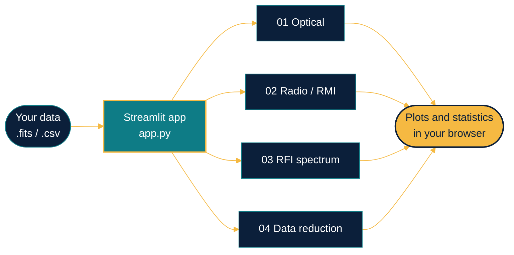
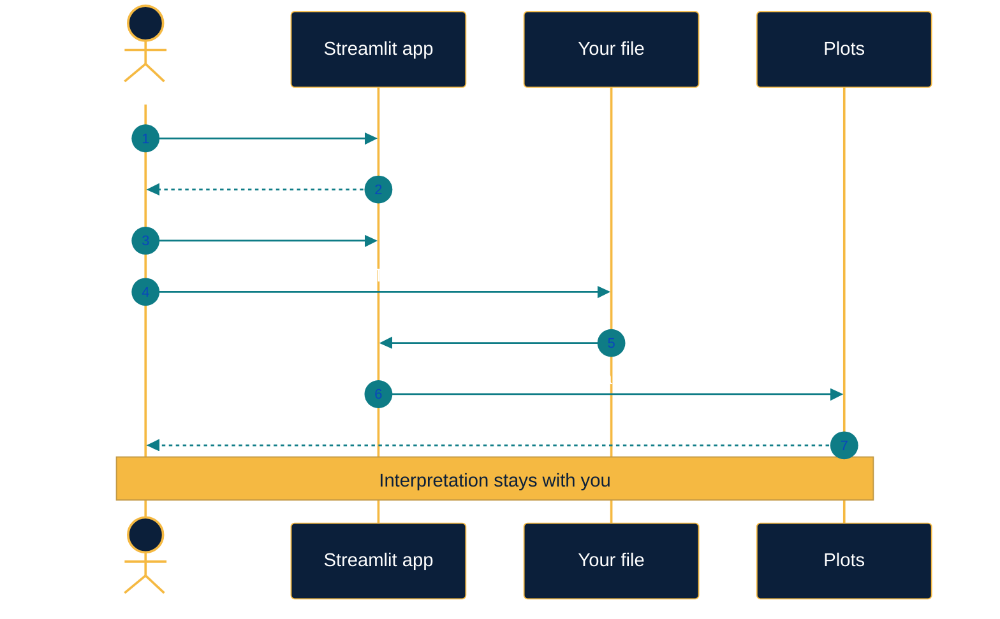
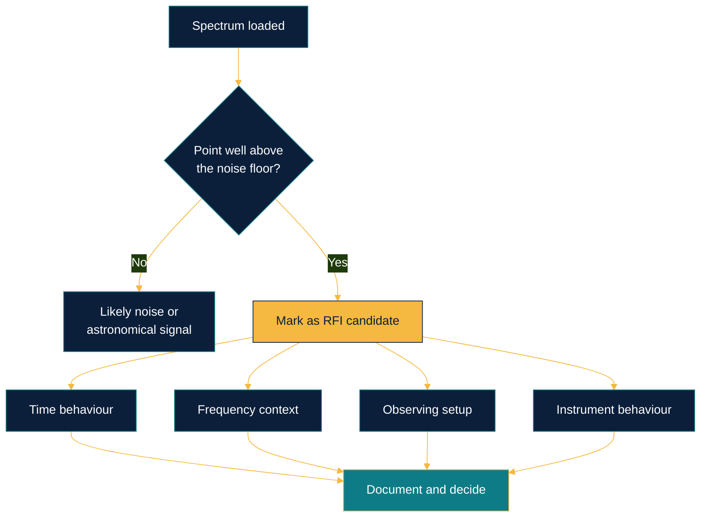

<div align="center">


<a href="https://git.io/typing-svg"></a>

<br/>


**A Python / Streamlit starter app for four practical areas of astronomy training, developed from the DARA practicals completed in Kenya.**

[Overview](#overview) · [Architecture](#architecture) · [Modules](#modules) · [Quick start](#quick-start) · [RFI workflow](#rfi-workflow) · [Data](#data-formats) · [Roadmap](#roadmap)

</div>

---

## Overview

One interactive browser app for the core skills of astronomy data work. Pick a practical in the sidebar, upload your data, and explore it visually.

<table>
<tr>
<td width="25%" valign="top"><b>01 · Optical</b><br/><sub>FITS images and their 2D image planes</sub></td>
<td width="25%" valign="top"><b>02 · Radio / RMI</b><br/><sub>Measurement time series, one or many columns</sub></td>
<td width="25%" valign="top"><b>03 · RFI</b><br/><sub>Frequency spectra with candidate flagging</sub></td>
<td width="25%" valign="top"><b>04 · Reduction</b><br/><sub>Descriptive statistics for numeric fields</sub></td>
</tr>
</table>

> [!IMPORTANT]
> **Scientific note.** This is a general-purpose learning toolkit, not a reconstruction of a specific DARA Kenya practical. Upload data you are permitted to use, document its source and units, and check instrument-specific requirements. High-power spectrum points are only candidates for investigation; they are not automatically confirmed RFI.

---

## Architecture



### Session flow



---

## Modules

| # | Module | Input | What you can do |
|:-:|:--|:-:|:--|
| 01 | **Optical astronomy** | `FITS` | Open an image file and inspect its 2D image plane before any reduction |
| 02 | **Radio / RMI** | `CSV` | Plot numeric measurement columns over time to spot drifts, steps and anomalies |
| 03 | **RFI spectrum** | `CSV` | Plot measured power against frequency and highlight high-power candidates |
| 04 | **Data reduction** | `CSV` | Compute descriptive statistics for any set of numeric fields |

---

## Quick start

```powershell
python -m venv .venv
.\.venv\Scripts\Activate.ps1
python -m pip install --upgrade pip
pip install -r requirements.txt
streamlit run app.py
```

<details>
<summary><b>PowerShell blocks activation?</b></summary>
<br/>

Use the virtual environment's Python directly:

```powershell
.\.venv\Scripts\python.exe -m pip install -r requirements.txt
.\.venv\Scripts\python.exe -m streamlit run app.py
```

</details>

The app opens in your browser. Choose a practical from the sidebar and upload a FITS or CSV file as appropriate.

---

## RFI workflow

A high-power point is a question, not an answer. Treat it like this:



---

## Data formats

| Module | Format | Required content |
|:--|:-:|:--|
| Optical | FITS | Image containing a 2D image plane |
| Radio / RMI | CSV | One or more numeric measurement columns |
| RFI | CSV | Numeric frequency and measured-power columns |
| Data reduction | CSV | Numeric fields to summarise |

> [!NOTE]
> The toolkit does not download training datasets automatically. Obtain data from a documented public archive, or use data you are authorised to share. Include attribution, units, instrument details and licensing where applicable.

---

## Roadmap

- [ ] Tests and example datasets with known provenance
- [ ] Celestial coordinate handling using WCS
- [ ] Radio calibration and domain-specific reduction, once the instrument and data format are known
- [ ] Validated RFI analysis that considers time, frequency, observing context and instrument behaviour
- [ ] Screenshots and a short demo GIF of each module

---

## Project structure

```text
.
├── app.py              Streamlit entry point
├── requirements.txt    Python dependencies
└── README.md
```

---

<div align="center">

**Luthando Candlovu** · Computer Science Honours · South Africa

[](https://github.com/LuthandoCandlovu)


</div>
