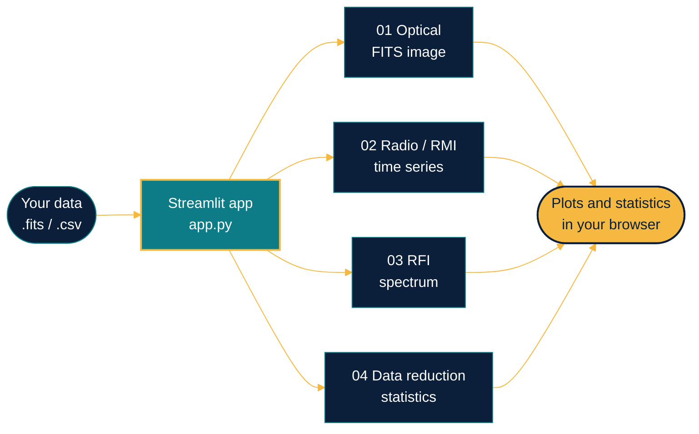
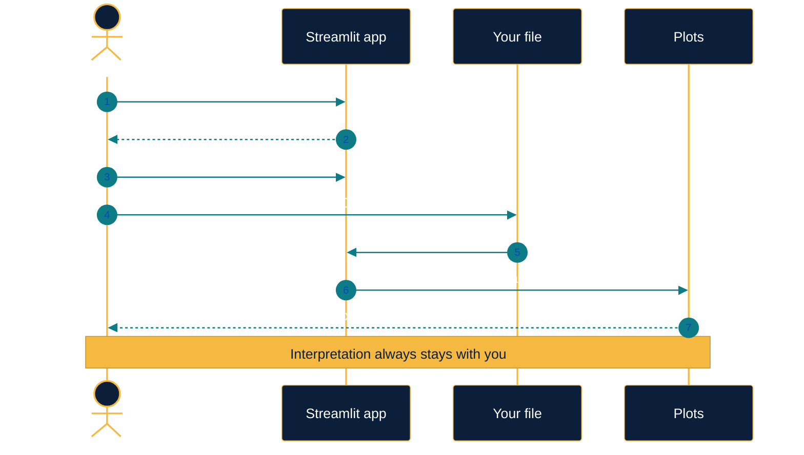
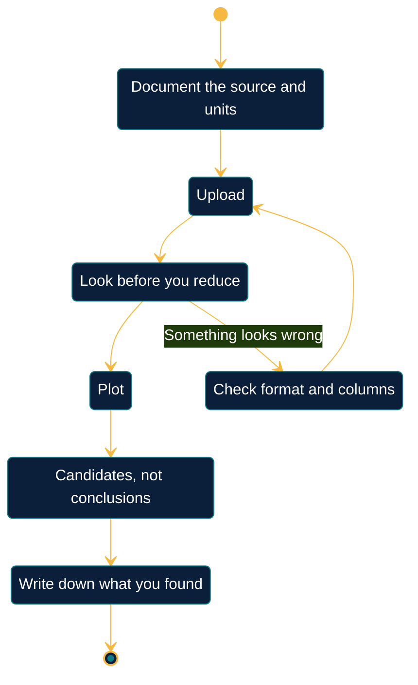
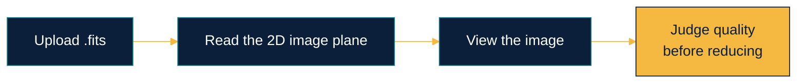
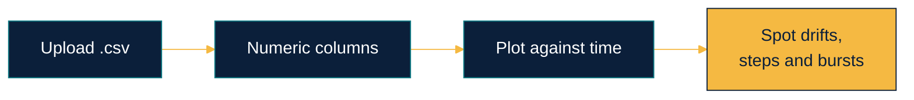
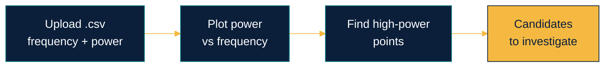
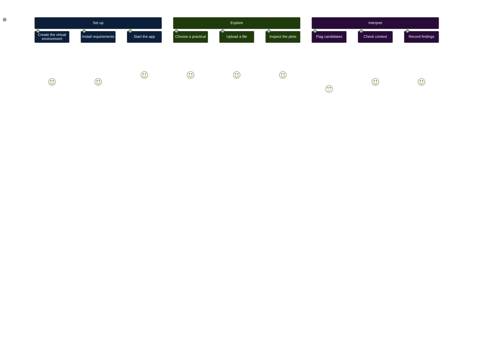
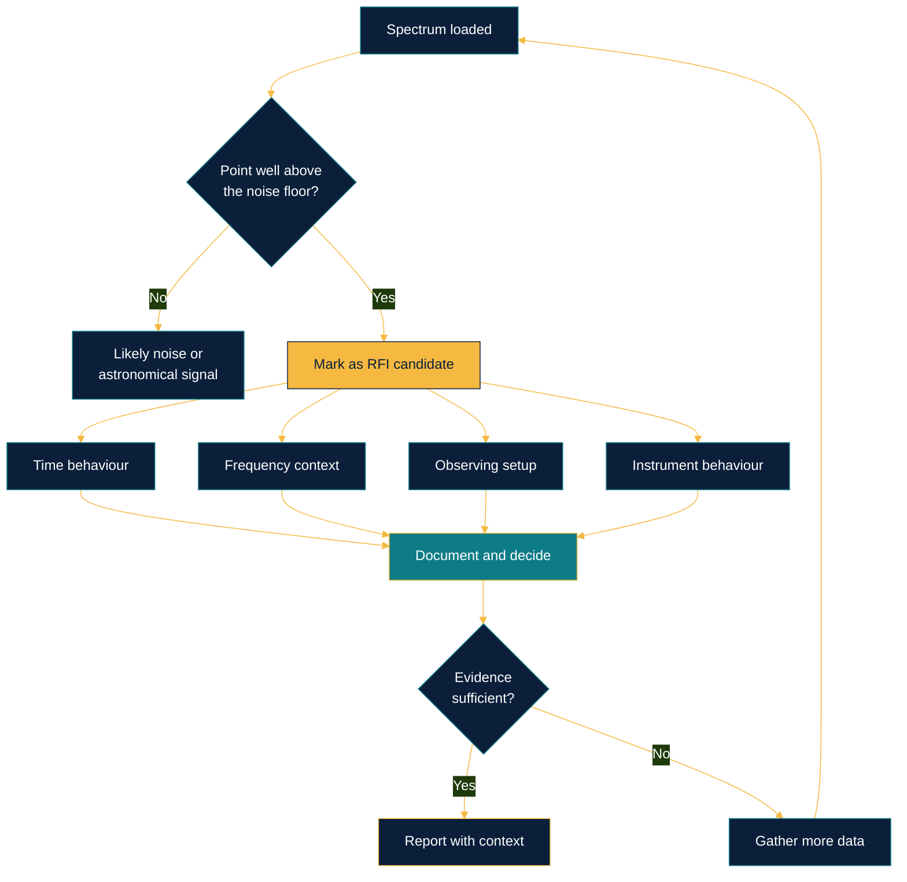
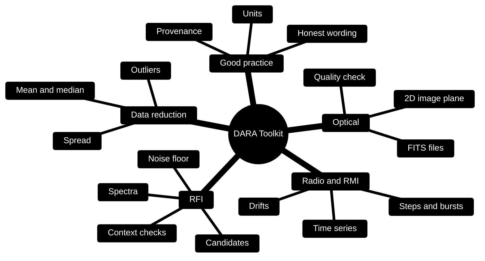
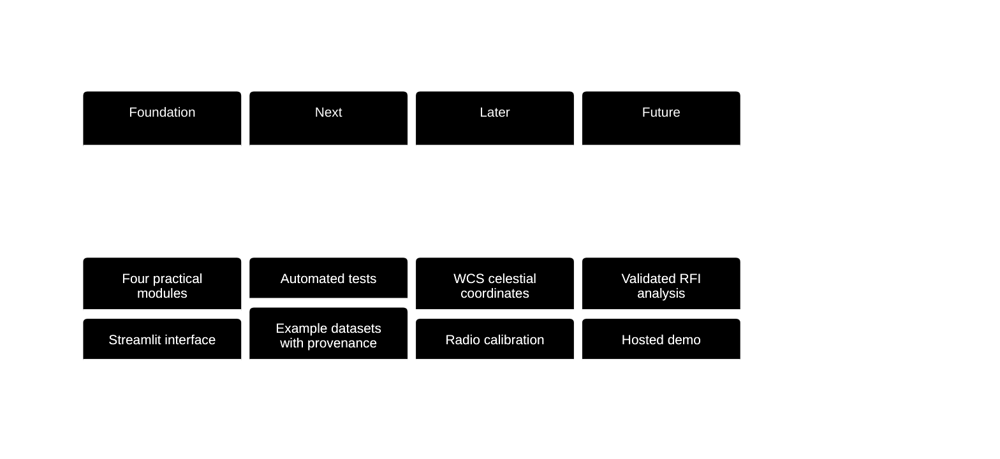

<div align="center">


<a href="https://git.io/typing-svg">
  
</a>

<br/><br/>


<br/>

**A Python / Streamlit starter application for exploring four practical areas of astronomy training,<br/>developed from the DARA practicals completed in Kenya.**

<br/>

[**Overview**](#overview) &nbsp;·&nbsp;
[**Architecture**](#architecture) &nbsp;·&nbsp;
[**Modules**](#modules) &nbsp;·&nbsp;
[**Quick start**](#quick-start) &nbsp;·&nbsp;
[**RFI**](#rfi-workflow) &nbsp;·&nbsp;
[**Data**](#data-formats) &nbsp;·&nbsp;
[**FAQ**](#faq) &nbsp;·&nbsp;
[**Roadmap**](#roadmap)

<br/>


</div>

<br/>

## Table of contents

1. [Overview](#overview)
2. [Architecture](#architecture)
3. [Modules](#modules)
4. [Quick start](#quick-start)
5. [Using the app](#using-the-app)
6. [RFI workflow](#rfi-workflow)
7. [Data formats](#data-formats)
8. [Responsible data use](#responsible-data-use)
9. [Concepts glossary](#concepts-glossary)
10. [Learning map](#learning-map)
11. [FAQ](#faq)
12. [Roadmap](#roadmap)
13. [Project structure](#project-structure)
14. [Author](#author)

<br/>

---

<br/>

## Overview

Astronomy data work is built from a small set of repeatable skills: look at an image, follow a signal through time, examine a spectrum, and summarise numbers honestly. This toolkit puts those four skills into **one interactive browser app**, so a practical becomes a few clicks instead of a new script each time.

<table>
<tr>
<td width="25%" valign="top" align="center">
<h3>01</h3>
<b>Optical</b><br/><br/>
<sub>Open a FITS file and inspect its 2D image plane before any reduction.</sub>
</td>
<td width="25%" valign="top" align="center">
<h3>02</h3>
<b>Radio / RMI</b><br/><br/>
<sub>Plot one or more numeric measurement columns as a time series.</sub>
</td>
<td width="25%" valign="top" align="center">
<h3>03</h3>
<b>RFI</b><br/><br/>
<sub>View power against frequency and mark high-power candidates.</sub>
</td>
<td width="25%" valign="top" align="center">
<h3>04</h3>
<b>Data reduction</b><br/><br/>
<sub>Summarise numeric fields with descriptive statistics.</sub>
</td>
</tr>
</table>

<br/>

> [!IMPORTANT]
> **Scientific note.** This is a general-purpose learning toolkit, not a reconstruction of a specific DARA Kenya practical. Upload data you are permitted to use, document its source and units, and check instrument-specific requirements. High-power spectrum points are only candidates for investigation; they are not automatically confirmed RFI.

<br/>

### Why a single app?

| Before | With the toolkit |
|:--|:--|
| A separate script or notebook for each exercise | One app, four practicals in the sidebar |
| Re-writing plotting code for every new file | Upload a file and the plots are built for you |
| Results that are hard to share with a supervisor | A browser view anyone can reproduce with the same file |
| Easy to over-interpret a bright spike | A built-in reminder that candidates are not confirmed RFI |

<br/>

---

<br/>

## Architecture

The app has one entry point, `app.py`. The sidebar selects a practical, each practical reads the file you upload, and the result is drawn in the browser.



### Session flow



### Recommended data-handling flow



<br/>

---

<br/>

## Modules

| # | Module | Input | What you can do |
|:-:|:--|:-:|:--|
| 01 | **Optical astronomy** | `FITS` | Open an image file and inspect its 2D image plane before any reduction |
| 02 | **Radio / RMI** | `CSV` | Plot numeric measurement columns over time to spot drifts, steps and anomalies |
| 03 | **RFI spectrum** | `CSV` | Plot measured power against frequency and highlight high-power candidates |
| 04 | **Data reduction** | `CSV` | Compute descriptive statistics for any set of numeric fields |

<br/>

<details>
<summary><b>01 &nbsp;Optical astronomy: FITS image inspection</b></summary>

<br/>

**Input:** a FITS file containing a 2D image plane.

**Purpose:** a first look at an image before any processing. Seeing the raw frame is how you catch a wrong file, a blank exposure or an obvious artefact early.



| Look for | Why it matters |
|:--|:--|
| A frame that is blank or uniformly bright | Possible wrong file, wrong extension or saturated exposure |
| Streaks, gradients or repeating patterns | Often instrument or sky-background effects that need handling |
| Very bright or dead pixels | Common detector features |
| Plausible orientation and field | Confirms you opened the image you meant to |

</details>

<details>
<summary><b>02 &nbsp;Radio / RMI: measurement time series</b></summary>

<br/>

**Input:** a CSV file with one or more numeric measurement columns.

**Purpose:** follow a quantity through time. Slow drifts, sudden steps and short bursts all look different on a time series, and learning to tell them apart is a core radio-astronomy skill.



| Pattern | Typical reading |
|:--|:--|
| Slow, smooth trend | Drift, for example from temperature or gain changes |
| Sudden jump that stays | A step, possibly a configuration change |
| Short spike | A burst, which may be interference or a real transient |
| Regular repeating wiggle | Periodic behaviour worth tracing to its source |

</details>

<details>
<summary><b>03 &nbsp;RFI: frequency-spectrum exploration</b></summary>

<br/>

**Input:** a CSV file with numeric frequency and measured-power columns.

**Purpose:** see where power sits across frequency and flag unusually strong points as **candidates** for investigation. Radio-frequency interference is a daily reality for radio telescopes, so the first skill is learning to see it, and the second is learning not to over-claim it.



See the full [RFI workflow](#rfi-workflow) below.

</details>

<details>
<summary><b>04 &nbsp;Data reduction: descriptive statistics</b></summary>

<br/>

**Input:** a CSV file with numeric fields to summarise.

**Purpose:** reduce many numbers to a few that describe them honestly. Every other module rests on this habit.


| Measure | Tells you |
|:--|:--|
| Mean | The average level, easily pulled by outliers |
| Median | The middle value, more robust to outliers |
| Standard deviation | How widely values scatter around the mean |
| Minimum and maximum | The range, and a quick way to spot bad values |

A mean far from the median is itself a hint that outliers are present.

</details>

<br/>

---

<br/>

## Quick start

### Windows PowerShell

```powershell
python -m venv .venv
.\.venv\Scripts\Activate.ps1
python -m pip install --upgrade pip
pip install -r requirements.txt
streamlit run app.py
```

<details>
<summary><b>PowerShell blocks activation?</b></summary>

<br/>

Skip activation and call the virtual environment's Python directly:

```powershell
.\.venv\Scripts\python.exe -m pip install -r requirements.txt
.\.venv\Scripts\python.exe -m streamlit run app.py
```

</details>

<details>
<summary><b>macOS or Linux</b></summary>

<br/>

```bash
python3 -m venv .venv
source .venv/bin/activate
python -m pip install --upgrade pip
pip install -r requirements.txt
streamlit run app.py
```

</details>

<br/>

The app opens in your browser. Choose a practical from the sidebar and upload a FITS or CSV file as appropriate.

<div align="center">


</div>

<br/>

---

<br/>

## Using the app



1. **Start the app** with `streamlit run app.py`. Your browser opens automatically.
2. **Choose a practical** from the sidebar: optical, radio / RMI, RFI or data reduction.
3. **Upload a file** in the format that practical expects. See [Data formats](#data-formats).
4. **Inspect** the plots or statistics that appear.
5. **Interpret carefully.** A pattern is a starting point for questions, not a conclusion.
6. **Record** the source, units and what you concluded, so someone else can follow your reasoning.

| Habit | Reason |
|:--|:--|
| Keep a note of where each file came from | Results are only as good as their provenance |
| Write units next to every column | A number without units cannot be checked |
| Look at the raw data before summarising | Statistics can hide a problem a plot would reveal |
| Change one thing at a time | You can tell which change caused which effect |

<br/>

---

<br/>

## RFI workflow

A high-power point in a spectrum is a **question, not an answer**. The flowchart shows how to treat it.



| Check | Question to ask |
|:--|:--|
| **Time behaviour** | Does it persist, repeat on a schedule, or appear only briefly? |
| **Frequency context** | Does it sit in a band with a known transmitter or service? |
| **Observing setup** | Could pointing, band selection or configuration explain it? |
| **Instrument behaviour** | Is there an internal source, such as a clock or digital electronics? |

| Stage | Wording to use | Evidence needed |
|:--|:--|:--|
| Spotted in the plot | "high-power candidate" | A point above the noise |
| Checked against context | "probable RFI" | Time, frequency and setup all consistent |
| Verified | "confirmed RFI" | Source traced or reproduced independently |

> [!WARNING]
> Never label a spike as confirmed RFI from a single plot. The toolkit shows you candidates; confirming them needs observing context and knowledge of the instrument.

<br/>

---

<br/>

## Data formats

| Module | Format | Required content |
|:--|:-:|:--|
| Optical | `FITS` | An image containing a 2D image plane |
| Radio / RMI | `CSV` | One or more numeric measurement columns |
| RFI | `CSV` | Numeric frequency and measured-power columns |
| Data reduction | `CSV` | Numeric fields to summarise |

Column names below are only examples. What matters is that the values you want to analyse are numeric.

```csv
time,measurement_a,measurement_b
0,1.02,0.48
1,1.05,0.47
2,1.04,0.51
```

```csv
frequency,power
1400.0,-82.1
1400.5,-81.7
1401.0,-60.3
```

> [!NOTE]
> The toolkit does not download training datasets automatically. Obtain data from a documented public archive, or use data you are authorised to share. Include attribution, units, instrument details and licensing where applicable.

<br/>

---

<br/>

## Responsible data use

- [ ] I am permitted to use this data, and to share it if I am publishing it
- [ ] The source, such as an archive, instrument or course, is recorded
- [ ] Units are written down for every column
- [ ] Instrument and observing details are noted where they matter
- [ ] Any licence or attribution requirement is respected
- [ ] Interpretations are worded as candidates unless they have been confirmed

<br/>

---

<br/>

## Concepts glossary

<details>
<summary><b>Open the glossary</b></summary>

<br/>

| Term | Meaning |
|:--|:--|
| **FITS** | Flexible Image Transport System, the standard file format for astronomical images and tables |
| **2D image plane** | One two-dimensional array of pixel values inside a FITS file |
| **Time series** | A measured quantity recorded at successive times |
| **Drift** | A slow, gradual change of a measured quantity |
| **Spectrum** | Power or intensity shown as a function of frequency |
| **Noise floor** | The baseline level of random power that is always present |
| **RFI** | Radio-frequency interference, man-made or instrument-generated signal that contaminates observations |
| **Candidate** | A point flagged for investigation and not yet confirmed |
| **Outlier** | A value far from the rest of the data |
| **WCS** | World Coordinate System, the mapping from image pixels to sky coordinates |
| **Provenance** | The documented origin and history of a dataset |

</details>

<br/>

---

<br/>

## Learning map



<br/>

---

<br/>

## FAQ

<details>
<summary><b>The activation script is blocked on Windows. What now?</b></summary>

<br/>

Run the environment's Python directly:

```powershell
.\.venv\Scripts\python.exe -m streamlit run app.py
```

</details>

<details>
<summary><b>The terminal says streamlit is not recognised.</b></summary>

<br/>

Usually the virtual environment is not active, or the packages were not installed into it:

```powershell
.\.venv\Scripts\python.exe -m pip install -r requirements.txt
.\.venv\Scripts\python.exe -m streamlit run app.py
```

</details>

<details>
<summary><b>The browser did not open, or the port is busy.</b></summary>

<br/>

Streamlit prints a local address in the terminal; open it manually, or choose another port:

```powershell
streamlit run app.py --server.port 8502
```

</details>

<details>
<summary><b>My FITS file will not display.</b></summary>

<br/>

Check that the file really is FITS and holds a 2D image plane, which is what the optical module expects.

</details>

<details>
<summary><b>Is a spike in the RFI plot definitely interference?</b></summary>

<br/>

No. It is a candidate. Confirming it needs time behaviour, frequency context, the observing setup and knowledge of the instrument. See the [RFI workflow](#rfi-workflow).

</details>

<details>
<summary><b>Does this reproduce an official DARA practical?</b></summary>

<br/>

No. It is a general learning toolkit developed from the practicals, and it does not claim to reproduce any specific exercise.

</details>

<br/>

---

<br/>

## Roadmap



- [ ] Add tests and example datasets with known provenance
- [ ] Add celestial coordinate handling using WCS
- [ ] Add radio calibration and domain-specific reduction, only when the instrument and data format are known
- [ ] Add validated RFI analysis that considers time, frequency, observing context and instrument behaviour
- [ ] Add screenshots and a screen-recorded demo of each module

<br/>

---

<br/>

## Project structure

```text
.
├── app.py              Streamlit entry point
├── requirements.txt    Python dependencies
└── README.md
```

<br/>

---

<br/>

## Author

<div align="center">

**Luthando Candlovu**

Computer Science Honours &nbsp;·&nbsp; South Africa

<br/>

[](https://github.com/LuthandoCandlovu)

<br/>


<br/><br/>

*Built with curiosity under African skies.*


</div>
