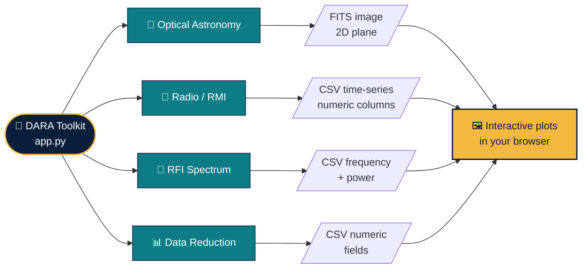
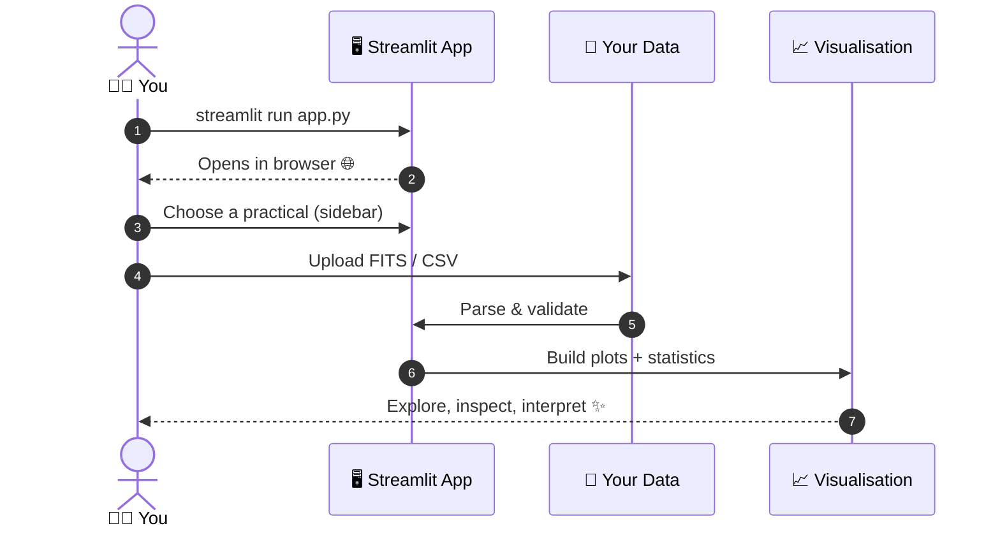
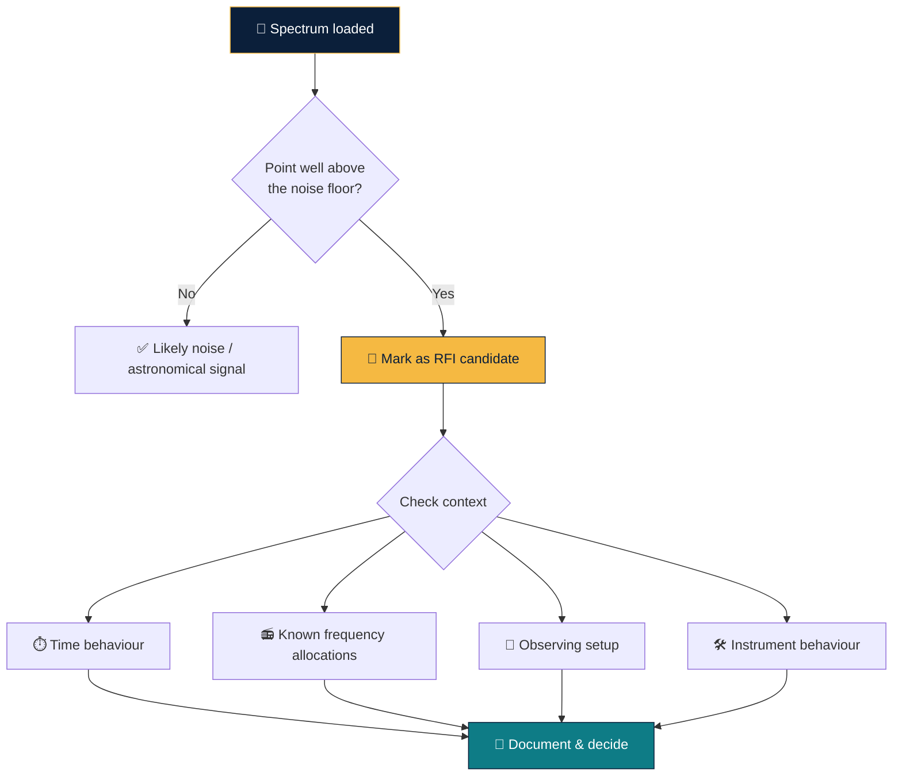

<div align="center">


<a href="https://git.io/typing-svg">
  
</a>

<br/>


**A Python / Streamlit starter application for exploring four practical areas of astronomy training.**
*Built from the DARA practicals completed in Kenya* 🇰🇪

[✨ Overview](#-overview) •
[🧭 Modules](#-modules) •
[🚀 Quick Start](#-quick-start) •
[📂 Data Formats](#-data-formats) •
[🛣️ Roadmap](#%EF%B8%8F-roadmap)

</div>

---

## ✨ Overview

This toolkit brings the core skills practised in astronomy training into **one interactive browser app**. Pick a practical from the sidebar, upload your data, and explore it visually: no notebooks to juggle, no scripts to rewrite.

<div align="center">

| 🔭 Optical | 📡 Radio / RMI | 📶 RFI | 📊 Data Reduction |
|:---:|:---:|:---:|:---:|
| FITS image inspection | Measurement time-series | Frequency-spectrum exploration | Descriptive statistics |
| `.fits` | `.csv` | `.csv` | `.csv` |

</div>

> [!IMPORTANT]
> **Scientific note.** This is a general-purpose learning toolkit, **not** a reconstruction of a specific DARA Kenya practical. Upload only data you are permitted to use, document its source and units, and check instrument-specific requirements.
> High-power spectrum points are **candidates for investigation**, not automatically confirmed RFI.

---

## 🧭 Modules

<div align="center">



</div>

### 🔭 1. Optical Astronomy: FITS Image Inspection
Load a FITS file, inspect its header, and view the 2D image plane. A first step in any imaging pipeline: check the data before you reduce it.

### 📡 2. Radio / RMI Time-Series Exploration
Upload a CSV with one or more numeric measurement columns and watch how signals evolve over time. Useful for spotting drifts, steps, and unusual behaviour.

### 📶 3. RFI Frequency-Spectrum Exploration
Plot measured power against frequency and flag high-power points as **RFI candidates**. Radio-frequency interference is a daily reality for radio telescopes, so the first skill is learning to *see* it.

### 📊 4. General Data Reduction & Descriptive Statistics
Summarise any numeric CSV with mean, median, spread and more, the foundation under every other module.

---

## 🔄 How a Practical Flows

<div align="center">



</div>

---

## 🚀 Quick Start

### 🪟 Windows PowerShell

```powershell
python -m venv .venv
.\.venv\Scripts\Activate.ps1
python -m pip install --upgrade pip
pip install -r requirements.txt
streamlit run app.py
```

<details>
<summary><b>🔒 Activation blocked? Click here</b></summary>

<br/>

Use the virtual environment directly, with no activation needed:

```powershell
.\.venv\Scripts\python.exe -m pip install -r requirements.txt
.\.venv\Scripts\python.exe -m streamlit run app.py
```

</details>

The app opens in your browser. Choose a practical from the sidebar and upload a FITS or CSV file as appropriate. 🎉

---

## 📂 Data Formats

| Module | Format | Required content |
|:--|:--:|:--|
| 🔭 **Optical** | `FITS` | An image containing a 2D image plane |
| 📡 **Radio / RMI** | `CSV` | One or more numeric measurement columns |
| 📶 **RFI** | `CSV` | Numeric **frequency** and measured **power** columns |
| 📊 **Data Reduction** | `CSV` | Numeric fields to summarise |

> [!NOTE]
> The toolkit does **not** download training datasets automatically. Obtain data from a documented public archive, or use data you are authorised to share. Always include **attribution, units, instrument details and licensing** where applicable.

---

## 🧪 Reading an RFI Spectrum

<div align="center">



</div>

A bright spike is a **question, not an answer**. Confirming RFI means considering time, frequency, observing context and instrument behaviour together.

---

## 🛣️ Roadmap

- [ ] 🧪 Add tests and example datasets with known provenance
- [ ] 🌍 Add celestial coordinate handling using **WCS**
- [ ] 📡 Add radio calibration and domain-specific reduction, once the instrument/data format is known
- [ ] 🛡️ Add validated RFI analysis that considers time, frequency, observing context and instrument behaviour

---

## 🗂️ Project Structure

```text
📦 dara-astronomy-practicals
 ┣ 📜 app.py             # Streamlit entry point
 ┣ 📜 requirements.txt   # Python dependencies
 ┗ 📜 README.md          # You are here ✨
```

---

<div align="center">

### 👋 Author

**Luthando Candlovu**
Computer Science Honours Student · South Africa 🇿🇦

[](https://github.com/LuthandoCandlovu)

*Built with curiosity under African skies* 🌌


</div>
